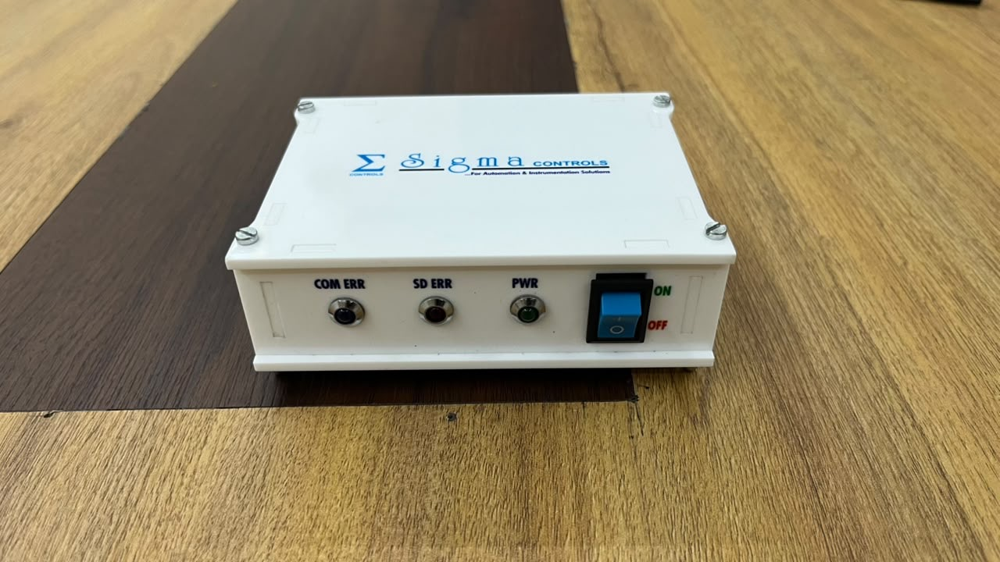
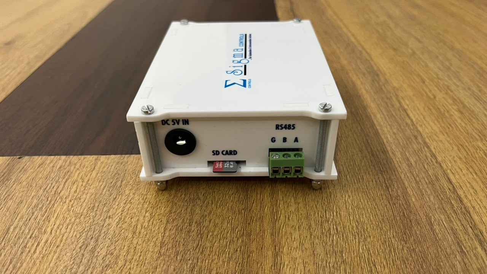
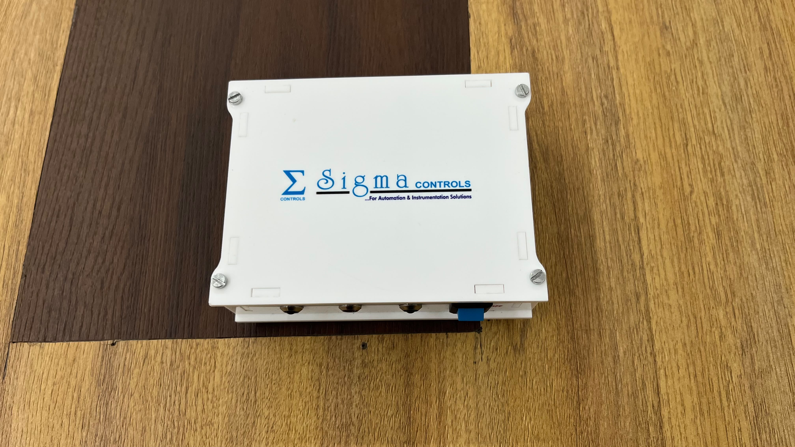
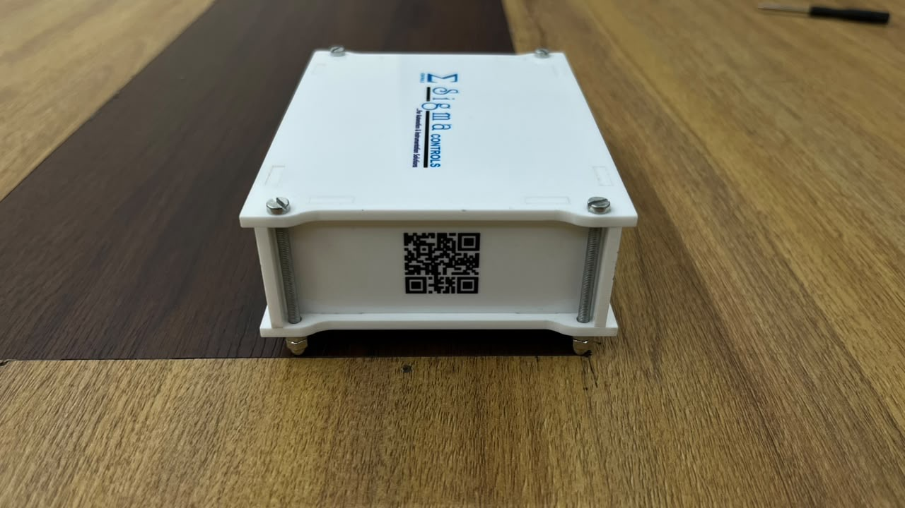
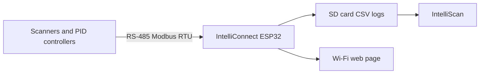

<div align="center">

# 📡 IntelliConnect

### Standalone ESP32 wireless data logger for industrial RS-485 Modbus devices


<table>
<tr>
<td align="center" width="50%"><br/><b>Front panel</b><br/>Status LEDs and power switch</td>
<td align="center" width="50%"><br/><b>Connector side</b><br/>DC 5 V input, SD card slot and RS-485 terminal</td>
</tr>
<tr>
<td align="center" width="50%"><br/><b>Top view</b></td>
<td align="center" width="50%"><br/><b>Side panel</b><br/>QR-code label</td>
</tr>
</table>

</div>

---

## Overview

IntelliConnect is a compact, standalone data logger built at **Sigma Controls**. It reads temperature scanners and PID controllers over **Modbus RTU on RS-485**, logs every reading to an **SD card**, and serves a **Wi-Fi web page** for setup and live graphs. It needs no PC and no Raspberry Pi, and it costs less than half of the Raspberry Pi logger.

It is part of a three-product ecosystem: the **IntelliScan** Windows software, a **Raspberry Pi logger** for sites that need their data from anywhere in the world, and this **ESP32 logger** for sites that monitor inside their own Wi-Fi.

> The source code is proprietary and is not published in this repository. It contains photos, demo videos and a description of the product.

---

## 🎬 Demo videos

▶ **[Watch the demo playlist on YouTube](https://www.youtube.com/playlist?list=PLd4IFcHaWRts)**: four videos of the logger running, recorded by a client.

| | | | |
|:--:|:--:|:--:|:--:|
| [](https://youtube.com/shorts/RAzEEAkBLWU) | [](https://youtu.be/da-MmFb8gtU) | [](https://youtube.com/shorts/4pPEepzqn5U) | [](https://youtube.com/shorts/ZYPtovwzIck) |
| **Demo 1** | **Demo 2** | **Demo 3** | **Demo 4** |

---

## ✨ Features

### Data acquisition
- **RS-485 Modbus RTU** master for industrial temperature scanners and PID controllers
- **Up to 16 Modbus slaves** on one line
- **Dynamic slave configuration**: add and change slaves from the web page, with no reflashing

### Local logging
- **SD card logging** in CSV files
- **CSV files open directly in IntelliScan**, the Sigma Controls desktop software, for graphs, tables and PDF reports
- **Configuration stored on the SD card**, so settings survive power cuts
- **Time-stamped data** with time synchronised over NTP

### Wi-Fi web interface
- **Live graphs** in the browser (Chart.js), responsive on phone and PC
- **Setup from the browser**: no app or cable needed
- **Hotspot / local access-point mode** for sites with no Wi-Fi network, as well as joining an existing network
- Works on any device with a browser inside the Wi-Fi range

### Reliability and maintenance
- **OTA (over-the-air) firmware updates**, so devices in the field can be updated without visiting the site
- **Status LEDs** on the front panel: **COM ERR** (Modbus communication error), **SD ERR** (SD card error) and **PWR** (power)
- **ON/OFF switch** on the front panel
- **Custom enclosure** with labelled connectors and a QR-code label

---

## 🔌 Connections and indicators

| Where | Label | Purpose |
|---|---|---|
| Front panel | **COM ERR** | Lights up on a Modbus communication error |
| Front panel | **SD ERR** | Lights up on an SD card error |
| Front panel | **PWR** | Power indicator |
| Front panel | **ON / OFF** | Power switch |
| Connector side | **DC 5V IN** | 5 V DC power input |
| Connector side | **SD CARD** | microSD slot for CSV logs and configuration |
| Connector side | **RS485 (G, B, A)** | 3-pin screw terminal for the Modbus line |

---

## 🧭 How it works

```
Scanners / PID controllers
        │  RS-485 (Modbus RTU)
        ▼
 IntelliConnect (ESP32)
        ├──► SD card (CSV logs) ──► IntelliScan (Windows software)
        └──► Wi-Fi web page (setup and live graphs)
```



---

<!--
Web interface screenshots: add them to assets/screenshots/ and uncomment this section.

## 🖥️ Web interface

| Live graph | Slave configuration | Settings |
|:--:|:--:|:--:|
|  |  |  |
-->

---

## 🧩 The Sigma Controls ecosystem

| Product | Best for |
|---|---|
| **IntelliScan** | Windows software: live graphs, tables, CSV logging and PDF reports for scanners |
| **Raspberry Pi logger** | Sites that need their data from anywhere in the world, on any network |
| **IntelliConnect (this device)** | Compact, low-cost monitoring inside the site's own Wi-Fi |

All of them work together: logs from the ESP32 and the Raspberry Pi open directly in IntelliScan.

### What's next
- A **better version of the ESP32 data logger**, with access from anywhere in the world
- **IntelliControl**: extending this RS-485 ecosystem from temperature scanners to PID controllers

---

## 🛠️ Built with

ESP32 · C++ · PlatformIO · Modbus RTU (RS-485) · SD card · Chart.js web UI · NTP · OTA updates

---

## 📬 Contact

Built by **Sneh Shah** as part of Sigma Controls' product line.
For details or collaboration: **snehshah.tech@gmail.com** · [GitHub](https://github.com/snehshah-tech-2004)
